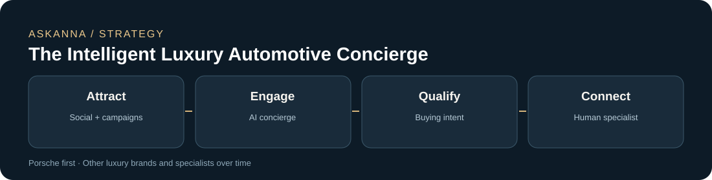
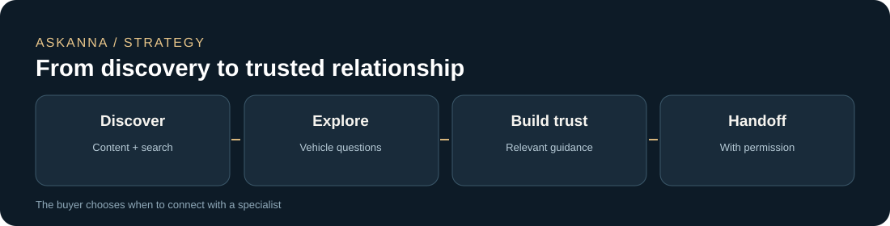
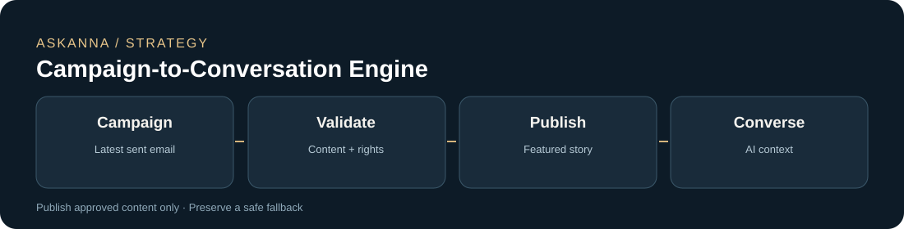

# AskAnna — The Intelligent Luxury Automotive Concierge

> **Business vision and product strategy**  
> October 2026 · Concept proposal · Not an implementation specification

## Executive summary

**AskAnna should become an AI-powered luxury automotive relationship and sales platform**, initially specializing in Porsche while remaining extensible to other premium brands such as Mercedes-Benz. The objective is not to maximize chatbot usage or automated messages: it is to create meaningful conversations that result in qualified opportunities for Anna and other sales specialists.

The proposed differentiation combines three capabilities:

1. **Campaign-to-Conversation Engine** — turn the latest approved marketing campaign into relevant website content and AI conversation starters, without duplicating work.
2. **AI Luxury Concierge** — provide a premium, mobile-first, knowledgeable automotive experience that helps visitors explore models and make informed choices.
3. **Intelligent Human Handoff** — recognize buying intent, ask permission to connect, and transfer useful context to the right sales specialist.

**Core principle:** AI develops the relationship; a human specialist handles high-value sales conversations.

---

## 1. The business opportunity

Luxury automotive buyers often research models, configurations, driving experiences, and ownership questions before they are ready to contact a salesperson. AskAnna can provide useful assistance throughout that journey, without pushing every visitor into an immediate sales conversation.

The business model has four connected aims:

- **Attract** potential buyers through social content, campaigns, search, and referrals.
- **Engage** with accurate, relevant, Porsche-oriented AI guidance.
- **Qualify** interest based on what customers ask and what they explicitly request.
- **Convert** qualified interest into conversations, appointments, test drives, and ultimately vehicle sales.

### Initial market position

**Suggested positioning:** *AskAnna — Your Personal Porsche Concierge.*

Porsche should lead the customer-facing experience initially because it provides a clear specialty. Other luxury marques and multiple sales operators can be supported later without making the initial brand experience generic.

---

## 2. The customer experience

The public site should feel like a premium automotive concierge, not a generic chatbot dashboard.

**Visitor experience**

- A polished, mobile-first homepage with high-quality, properly licensed automotive imagery and video.
- A current featured campaign, such as a new 911 Carrera GTS story.
- Natural prompts: “Which 911 fits my driving style?” or “How does the Carrera GTS compare with the Carrera 4 GTS?”
- Answers grounded in verified manufacturer and approved dealership information; current inventory, price, and availability must not be guessed.
- An optional invitation to speak with Anna or another specialist at an appropriate moment.

**Example conversation**

> **Visitor:** I'm considering a 911 Carrera GTS, but I'm unsure whether all-wheel drive is right for me.  
> **AskAnna:** I can explain the practical differences and help narrow down what matters to you. Is your priority everyday driving, performance, or weather conditions?  
> **Visitor:** I may buy within three months. Can I arrange a test drive?  
> **AskAnna:** Certainly. Would you like me to connect you with a Porsche specialist to discuss available options and a test drive?

This illustrates a desired experience, not a promise of real-time inventory or booking integrations.

---

## 3. Campaign-to-Conversation Engine

A key requirement is that **the latest successfully sent marketing template should inform the public experience**. This should not mean copying raw email HTML onto the homepage.

**Proposed workflow**

1. An approved campaign is sent from the existing marketing administration system.
2. A publishing service reads the campaign content and references to its assets.
3. It extracts reusable descriptions, featured models, images, video, and relevant calls to action.
4. It checks whether each item is suitable and authorized for public use.
5. The public homepage updates its featured campaign; the AI receives approved campaign context and suggested conversation starters.
6. If publishing fails, the site continues showing the last valid public campaign or evergreen content.

### Public content rules

| Content type | Recommended treatment |
| --- | --- |
| General model descriptions and approved promotional copy | Eligible for public reuse |
| Images and video | Reuse only when public usage rights are confirmed |
| Driving-experience narratives | Adapt into homepage stories and conversation prompts |
| Personalized offers, individual pricing, customer details | Do **not** publish without explicit authorization; private customer information stays private |
| Time-limited promotions | Show only during their approved validity window |
| Missing or broken media | Use an approved fallback; never break the public site |

**Important:** “Latest sent” is a content source, **not blanket permission to publish**. A lightweight approval policy is necessary even if much of the publishing process becomes automated.

---

## 4. When should AI involve a sales specialist?

Use a **hybrid qualification approach**: explicit customer requests take priority; buying signals guide when AskAnna *offers* human assistance. A lead score is not permission to contact someone.

| Customer signal | AskAnna response | Human involvement |
| --- | --- | --- |
| Requests a callback, quote, appointment, or test drive | Offer an immediate handoff | Route promptly after the visitor agrees and supplies a contact method |
| Asks about availability, financing, trade-ins, or a purchase timeframe | Explore needs and offer specialist assistance | Route when contact is requested or accepted |
| Compares specific models and configurations | Provide verified guidance and relevant follow-up questions | Optional, not forced |
| Browses general vehicle information | Continue helping without pressure | Not necessary |

### Handoff brief — illustrative example

> **Interest:** Porsche 911 Carrera GTS  
> **Question:** Rear-wheel drive versus all-wheel drive  
> **Buying horizon:** Approximately three months  
> **Origin:** LinkedIn campaign  
> **Requested next step:** Test-drive discussion  
> **Suggested specialist:** Anna (Porsche)  
> **AI summary:** Visitor is comparing GTS configurations and requested help with test-drive options.

Only share conversation context and personal details with authorized operators under a clear privacy notice and appropriate consent or other lawful basis.

**Recommendation:** Start with transparent intent categories and straightforward routing rules. Improve them using real outcomes instead of inventing a complex AI scoring model on day one.

---

## 5. Social acquisition: start with LinkedIn, not end with it

LinkedIn is the initial social channel. The product should not depend on unrestricted automated personal messages, scraping, or access that the platform has not approved.

A practical first approach is:

- Publish or promote approved content through authorized channels.
- Use compliant links and available lead-generation features to invite visitors to AskAnna.
- Let visitors begin an AI conversation voluntarily.
- Capture source attribution and contact preferences.
- Expand to other channels once the acquisition-to-handoff process works.

The goal is **qualified conversations**, not maximum message volume. Follow-ups should respect platform rules, customer preferences, and opt-outs.

---

## 6. Multiple specialists and future luxury brands

The public identity can remain centered on Anna as a trusted Porsche concierge, while the operational model supports other specialists.

Possible future routing dimensions include:

- Vehicle brand or model expertise.
- Geography and dealership coverage.
- Specialist availability.
- Customer language and preferred contact channel.
- Explicit customer choice.

Other premium brands, including Mercedes-Benz, can be introduced with separate verified knowledge, approved brand assets, and appropriate specialists. **Expand only after the Porsche experience demonstrates commercial value.**

---

## 7. Private and public separation

The product needs clearly separated **public customer engagement** and **private operator/customer administration** experiences, inspired by the two-sided operating model discussed for EMC-Nav.

A proposed URL scheme could be:

| Experience | Example URL |
| --- | --- |
| Public concierge | `askanna.online` |
| Private prospect/sales workspace | `studio.askanna.online` |
| Existing customer administration | `admin.askanna.online` |

These are illustrative names, not deployed endpoints. **Different URLs alone do not create a security firewall.** Real separation requires authentication, role-based authorization, protected APIs, data isolation, and verified access boundaries. Existing customer records must not become visible to new public visitors or unauthorized sales operators.

---

## 8. Lessons from DD and EMC-Nav

The strategic inspiration is **methodology rather than code reuse**:

- Build a working model early so it can be evaluated in realistic use.
- Use AI to accelerate prototyping, language design, customer interaction, and iteration.
- Keep public and private experiences understandable and appropriately isolated.
- Refine the experience frequently based on real customer and operator feedback.

Speed should not remove production safeguards: access controls, basic tests, observability, backups, and a rollback path remain essential.

---

## 9. How success should be measured

| Metric | Business question |
| --- | --- |
| Visitors by channel | Which sources attract potential buyers? |
| Meaningful AI conversations | Are visitors finding useful assistance? |
| Qualified buying interest | Are conversations uncovering genuine opportunities? |
| Requested specialist contacts | Is AI engagement leading to human conversations? |
| Operator response time | Are interested visitors receiving timely attention? |
| Appointments and test drives | Are opportunities progressing? |
| Attributed vehicle sales | Is AskAnna generating measurable business? |

Agree on attribution rules early, including what counts as a system-generated lead and how an eventual sale is credited. Avoid optimizing solely for chatbot sessions or messages sent.

---

## 10. Strategic roadmap

### Horizon 1 — Prove commercial value

Deliver a premium Porsche concierge, accurate AI answers, approved campaign synchronization, clear contact requests, and reliable handoff to Anna. Establish a compliant LinkedIn acquisition path and measure results.

### Horizon 2 — Improve conversion and operations

Introduce multiple operators, stronger attribution, better campaign analytics, more sophisticated permission-based follow-up, and additional social channels.

### Horizon 3 — Expand the platform

Explore other luxury automotive brands and potentially additional dealerships or sales organizations once the first use case has demonstrated repeatable value.

---

## 11. Decisions and validation still needed

- Confirm the precise public brand promise and how Anna is represented alongside future specialists.
- Define what campaign content is approved for public reuse and who can override or withdraw it.
- Confirm authorized LinkedIn features and operational account access.
- Define privacy, consent, retention, and handoff requirements for each market served.
- Confirm what constitutes a qualified lead, a completed handoff, and an attributable sale.
- Validate the proposed customer experience with real prospective buyers and sales specialists.

## Final recommendation

> **Build AskAnna around a Campaign-to-Conversation Engine, an AI Luxury Concierge, and an Intelligent Human Handoff.**
>
> The purpose is not to automate selling for its own sake. It is to turn approved marketing content and customer curiosity into informed, permission-based conversations that help human specialists sell luxury vehicles.

*This document is a strategic recommendation derived from product discussions and clarified requirements. Proposed features, sample customer journeys, names, and future opportunities are recommendations rather than confirmed production capabilities.*
